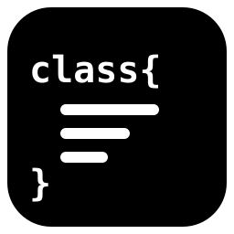

<div align="center">
  

  # qcstub

  Minimalist code structure generator for various programming languages

  [](./LICENSE)

  [](README.md)
  [](README.en.md)
</div>

## About

qcstub - a minimalist code structure generator for various programming languages. Supported languages: JavaScript, TypeScript, Python, Perl (pm), Lua, Ruby, PHP, Java. Supported platforms: Linux, FreeBSD.

**Purpose:**
Speeds up initial project design: instead of creating dozens of files by hand and typing keywords (`class`, `function`) in each of them, you can describe the project structure with a single command.
It is also suitable for existing projects when you need to add several classes with methods at once.

> [!WARNING]
> The project is under development. JavaScript, TypeScript and PHP are fully supported; templates for other languages may work incompletely.

If you find the idea useful, you are welcome to contribute.

## Features

**Several files in one command**
 - `qcstub dir/ A.js "..." B.js "..."` - the directory is created automatically

**A class described in one line**
 - `name=value` - a field, `name(params)` - a method
 - `public`, `private`, `protected`, `static`, `async`, `*` - a modifier applies to the next token
 - `Class.extension|Parent` - inheritance

**Customizable templates**
 - Templates are stored in `~/.config/qcstub/templates/<language>/*.tpl`

## Installation

**Linux, FreeBSD**
```
./install.sh
```

## Usage

**Example:**
```
qcstub . \
  Animal.js "name=Rex legs=4 private secret=42 speak() move(x,y) static create(name) async load(url)" \
  'Dog.js|Animal' "bark(times)"
```

**Result:**
`Animal.js`:
```js
class Animal{
	name = 'Rex';
	legs = 4;
	#secret = 42;

	speak(){

	}

	move(x, y){

	}

	static create(name){

	}

	async load(url){

	}
}

export default Animal;
```

`Dog.js`:
```js
class Dog extends Animal{
	bark(times){

	}
}

export default Dog;
```

## Technologies

- POSIX sh, awk

## License

Distributed under the terms of the BSD 2-Clause license, as stated
in the [LICENSE](./LICENSE) file.

```
Copyright (c) 2026, quardinimus
All rights reserved.

Redistribution and use in source and binary forms, with or without
modification, are permitted provided that the following conditions are met:

1. Redistributions of source code must retain the above copyright notice, this
   list of conditions and the following disclaimer.

2. Redistributions in binary form must reproduce the above copyright notice,
   this list of conditions and the following disclaimer in the documentation
   and/or other materials provided with the distribution.

THIS SOFTWARE IS PROVIDED BY THE COPYRIGHT HOLDERS AND CONTRIBUTORS "AS IS"
AND ANY EXPRESS OR IMPLIED WARRANTIES, INCLUDING, BUT NOT LIMITED TO, THE
IMPLIED WARRANTIES OF MERCHANTABILITY AND FITNESS FOR A PARTICULAR PURPOSE ARE
DISCLAIMED. IN NO EVENT SHALL THE COPYRIGHT HOLDER OR CONTRIBUTORS BE LIABLE
FOR ANY DIRECT, INDIRECT, INCIDENTAL, SPECIAL, EXEMPLARY, OR CONSEQUENTIAL
DAMAGES (INCLUDING, BUT NOT LIMITED TO, PROCUREMENT OF SUBSTITUTE GOODS OR
SERVICES; LOSS OF USE, DATA, OR PROFITS; OR BUSINESS INTERRUPTION) HOWEVER
CAUSED AND ON ANY THEORY OF LIABILITY, WHETHER IN CONTRACT, STRICT LIABILITY,
OR TORT (INCLUDING NEGLIGENCE OR OTHERWISE) ARISING IN ANY WAY OUT OF THE USE
OF THIS SOFTWARE, EVEN IF ADVISED OF THE POSSIBILITY OF SUCH DAMAGE.
```
