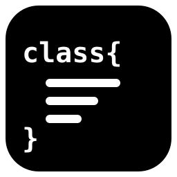

<div align="center">
  

  # qcstub

  Минималистичный генератор структуры кода для разных языков программирования

  [](./LICENSE)

  [](README.md)
  [](README.en.md)
</div>

## О проекте

qcstub - минималистичный генератор структуры кода для разных языков программирования. Поддерживаемые языки: JavaScript, TypeScript, Python, Perl (pm), Lua, Ruby, PHP, Java. Поддерживаемые платформы: Linux, FreeBSD.

**Назначение:**
Ускоряет начальное проектирование: вместо того чтобы создавать десятки файлов вручную и набирать в каждом ключевые слова (`class`, `function`), структуру проекта можно описать одной командой.
Также подходит для существующих проектов, когда нужно сразу добавить несколько классов с методами.

> [!WARNING]
> Проект находится в разработке. Полноценно поддерживаются JavaScript, TypeScript и PHP, шаблоны остальных языков могут работать неполноценно.

Если идея показалась вам полезной, вы можете внести свой вклад.

## Возможности

**Несколько файлов одной командой**
 - `qcstub каталог/ A.js "..." B.js "..."` - каталог создаётся автоматически

**Описание класса одной строкой**
 - `имя=значение` - поле, `имя(параметры)` - метод
 - `public`, `private`, `protected`, `static`, `async`, `*` - модификатор действует на следующий токен
 - `Класс.расширение|Родитель` - наследование

**Настройка шаблонов**
 - Шаблоны лежат в `~/.config/qcstub/templates/<язык>/*.tpl`

## Установка

**Linux, FreeBSD**
```
./install.sh
```

## Запуск

**Пример:**
```
qcstub . \
  Animal.js "name=Rex legs=4 private secret=42 speak() move(x,y) static create(name) async load(url)" \
  'Dog.js|Animal' "bark(times)"
```

**Результат:**
`Animal.js`:
```js
class Animal{
	name = 'Rex';
	legs = 4;
	#secret = 42;

	speak(){

	}

	move(x, y){

	}

	static create(name){

	}

	async load(url){

	}
}

export default Animal;
```

`Dog.js`:
```js
class Dog extends Animal{
	bark(times){

	}
}

export default Dog;
```

## Технологии

- POSIX sh, awk

## Лицензия

Распространяется на условиях лицензии BSD 2-Clause, как указано
в файле [LICENSE](./LICENSE).

```
Copyright (c) 2026, quardinimus
Все права защищены.

Распространение и использование в исходном и/или бинарном виде, с изменениями
или без, разрешено при соблюдении следующих условий:

1. При распространении исходного кода должно сохраняться указанное выше
   уведомление об авторских правах, этот список условий и следующий отказ
   от ответственности.

2. При распространении в бинарном виде должна воспроизводиться указанная
   выше информация об авторских правах, этот список условий и следующий
   отказ от ответственности в документации и/или других материалах,
   поставляемых с дистрибутивом.

ДАННОЕ ПРОГРАММНОЕ ОБЕСПЕЧЕНИЕ ПРЕДОСТАВЛЯЕТСЯ ПРАВООБЛАДАТЕЛЯМИ И АВТОРАМИ
«КАК ЕСТЬ», БЕЗ КАКИХ-ЛИБО ГАРАНТИЙ, ЯВНЫХ ИЛИ ПОДРАЗУМЕВАЕМЫХ, ВКЛЮЧАЯ, НО НЕ
ОГРАНИЧИВАЯСЬ, ПОДРАЗУМЕВАЕМЫЕ ГАРАНТИИ ТОВАРНОЙ ПРИГОДНОСТИ И ПРИГОДНОСТИ ДЛЯ
ОПРЕДЕЛЁННОЙ ЦЕЛИ. НИ ПРИ КАКИХ ОБСТОЯТЕЛЬСТВАХ ПРАВООБЛАДАТЕЛИ ИЛИ АВТОРЫ НЕ
НЕСУТ ОТВЕТСТВЕННОСТИ ЗА КАКИЕ-ЛИБО ПРЯМЫЕ, КОСВЕННЫЕ, СЛУЧАЙНЫЕ, ОСОБЫЕ,
ШТРАФНЫЕ ИЛИ КОСВЕННЫЕ УБЫТКИ (ВКЛЮЧАЯ, НО НЕ ОГРАНИЧИВАЯСЬ, ПРИОБРЕТЕНИЕ
ТОВАРОВ ИЛИ УСЛУГ ВЗАМЕН; ПОТЕРЮ ИСПОЛЬЗОВАНИЯ, ДАННЫХ ИЛИ ПРИБЫЛИ; ЛИБО
ПРЕРЫВАНИЕ ХОЗЯЙСТВЕННОЙ ДЕЯТЕЛЬНОСТИ), ВОЗНИКШИЕ ЛЮБЫМ ОБРАЗОМ И ПО ЛЮБОЙ
ТЕОРИИ ОТВЕТСТВЕННОСТИ, БУДЬ ТО ДОГОВОРНАЯ ОТВЕТСТВЕННОСТЬ, СТРОГАЯ
ОТВЕТСТВЕННОСТЬ ИЛИ ДЕЛИКТ (ВКЛЮЧАЯ ХАЛАТНОСТЬ ИЛИ ИНОЕ), ВОЗНИКШИЕ КАКИМ-ЛИБО
ОБРАЗОМ В РЕЗУЛЬТАТЕ ИСПОЛЬЗОВАНИЯ ДАННОГО ПРОГРАММНОГО ОБЕСПЕЧЕНИЯ, ДАЖЕ ЕСЛИ
БЫЛО СООБЩЕНО О ВОЗМОЖНОСТИ ТАКИХ УБЫТКОВ.
```
